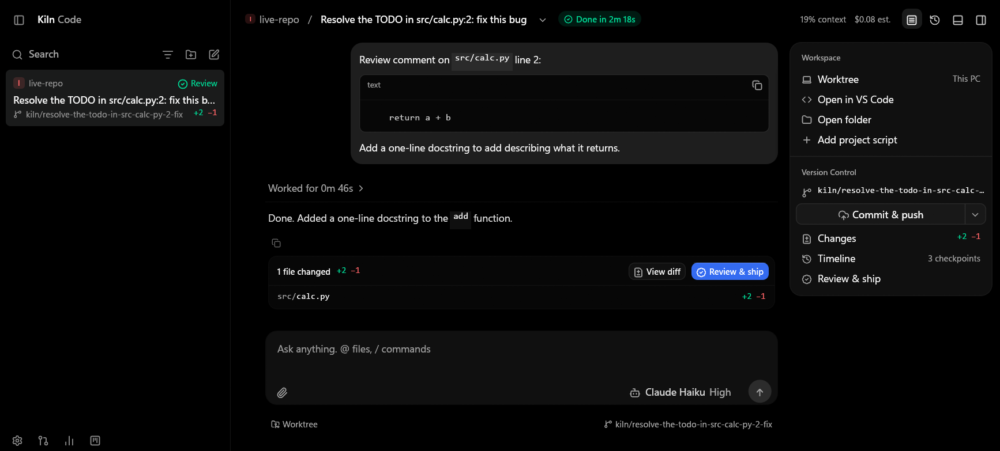
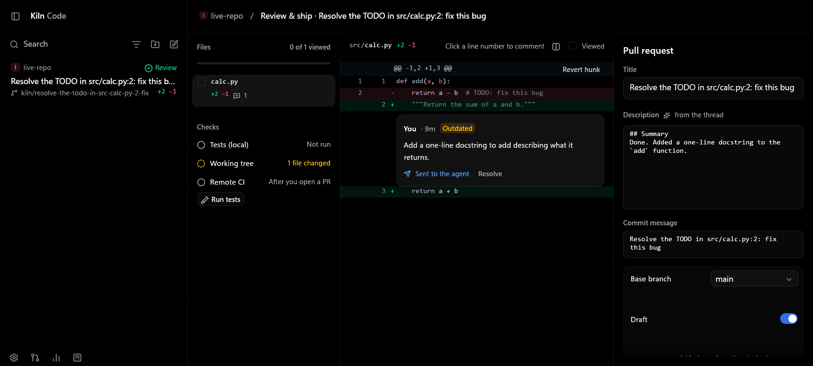
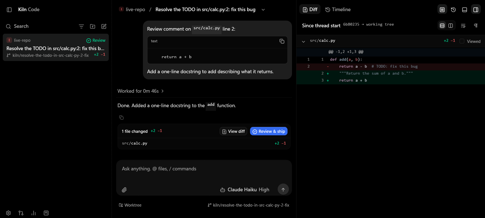
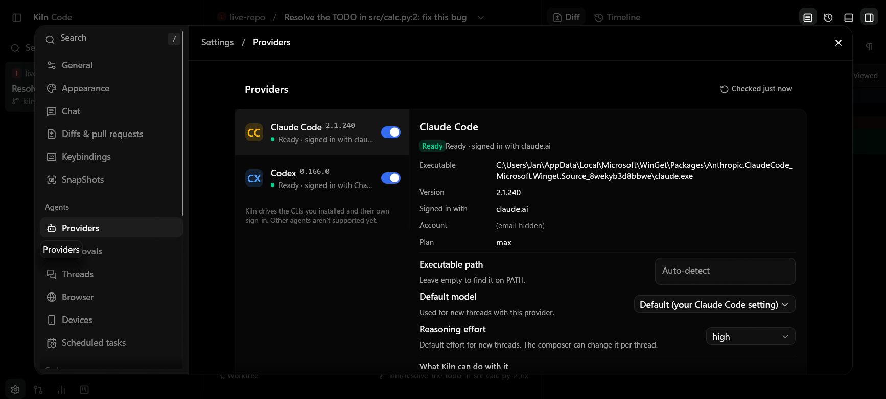
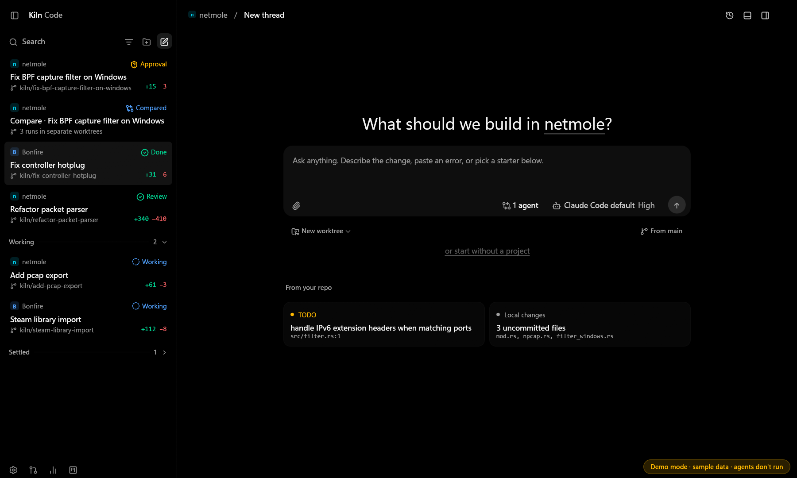
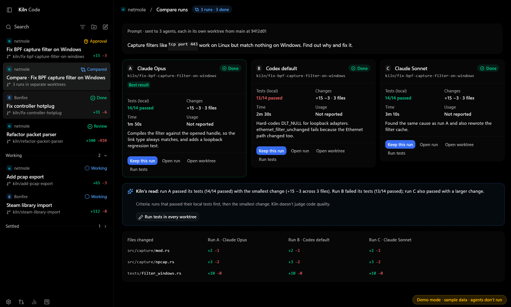
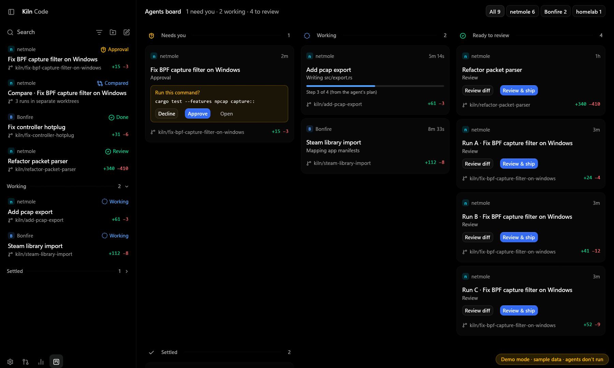

# Kiln Code

A native Rust desktop app for running the coding agents you already have: **Claude Code** and **Codex**. It manages projects, threads, Git worktrees, approvals, diffs, terminals, review and pull requests. Kiln drives the real provider CLIs and reuses their existing sign-in and subscriptions. There's no Kiln account, login, license or cloud service.

- **UI:** egui 0.37 + eframe on wgpu. No web view, Electron, Tauri, Node or JavaScript anywhere in Kiln.
- **Providers:** Claude Code over its stream-json control protocol; Codex over `codex app-server` JSON-RPC on stdio. Kiln never calls a model API itself.
- **Platform:** built and tested on Windows 11 Pro (x64, 26200). The code is portable (Linux/macOS paths exist), but those platforms are **untested**.



## Build and run

Requirements:

- Rust stable (built with 1.99), edition 2024.
- On Windows, the MSVC build tools. `rusqlite` bundles SQLite and compiles it with `cc`.
- Git on `PATH` (tested with 2.55).
- Optional:
  - Claude Code and/or Codex CLI.
  - GitHub CLI `gh`, for pull requests and GitHub suggestions.
  - VS Code (`code` on `PATH`), for "Open in VS Code".

```bash
cargo run --release
```

The release executable is `target/release/kiln-code.exe` (about 24 MB, no runtime dependencies besides the system).

Demo mode uses sample data in a temporary data folder, never touches your data, and never runs agents:

```bash
cargo run --release -- --demo
```

Validation commands (all pass):

```bash
cargo fmt --check
cargo check --workspace
cargo clippy --workspace --all-targets -- -D warnings
cargo test --workspace
cargo build --release
```

Live provider tests use your real provider login and cost a few small turns:

```bash
cargo test live_ -- --ignored --nocapture --test-threads=1
```

If you run them from inside another Claude Code session, unset the parent session's `CLAUDE*`/`ANTHROPIC*` variables first. Kiln itself strips only the nesting markers (`CLAUDECODE`, `CLAUDE_CODE_SESSION_ID`, …).

Environment variables for testing:

| Variable | Effect |
|---|---|
| `KILN_DATA_DIR` | Use another data folder. |
| `KILN_SCREENSHOT=out.png` | Save a PNG of the window after it settles (`KILN_SHOT_FRAMES`, `KILN_EXIT_AFTER_SHOT`). |
| `KILN_VIEW` | Open a given view: `new`, `board`, `compare`, `review`, `diff`, `timeline`, `terminal`, `palette`, `settings:<page>`. |
| `KILN_WINDOW=1440x900` | Initial window size. |

## Providers and sign-in

Kiln finds the CLIs from the path set in Settings → Providers, then `PATH`, then the usual install locations (WinGet, `%LOCALAPPDATA%\Programs\OpenAI\Codex\bin`, `~/.local/bin`, npm). Native `.exe` binaries win over script shims.

| Provider | Install | Sign in (in a terminal; Kiln never does it for you) | Health check (read-only) |
|---|---|---|---|
| Claude Code | `winget install Anthropic.ClaudeCode` or the native installer | `claude auth login` | `claude --version`, `claude auth status --json` |
| Codex | `winget install OpenAI.Codex` | `codex login` | `codex --version`; app-server `initialize` → `account/read {refreshToken:false}` → `model/list` → `account/rateLimits/read`; falls back to `codex login status` |

Health checks never start a login, never change provider settings and never start agent work. When a provider is missing or signed out:

- Settings → Providers shows the real status and the install or sign-in command.
- It can open a Kiln terminal running that command.

Everything else (projects, history, diffs, terminals, settings) keeps working.

**How Kiln reuses your existing sessions and subscriptions**

- **Claude Code** runs as `claude -p --input-format stream-json --output-format stream-json --verbose --include-partial-messages --permission-prompt-tool stdio`. This is the same CLI protocol the Claude Agent SDK uses, verified against 2.1.240.
  - Kiln never passes `--bare` or an API key, so the CLI uses whatever you configured. `apiKeySource: "none"` in the init record means your claude.ai subscription.
  - If the CLI reports a different key source, Kiln says so in the thread.
  - The `session_id` from the `system/init` record is stored as the thread's provider session id, separate from Kiln's own thread id. Later turns after a restart use `--resume <id>`.
- **Codex** runs as `codex app-server`.
  - Kiln sends `thread/start`, or `thread/resume` with the stored Codex thread id, then `turn/start`, `turn/steer` and `turn/interrupt`.
  - Codex keeps its own login (ChatGPT or API key) and enforces its own sandbox.
  - The protocol was checked against the JSON Schema the installed binary generates (`codex app-server generate-json-schema`, codex-cli 0.166.0).

Conversations don't move between providers. A thread belongs to one provider; "Fork a thread from here" starts a *new* provider session and says that the agent doesn't have the earlier conversation.

## Approvals

Provider permission requests arrive as Claude `control_request{can_use_tool}` or Codex `item/commandExecution|fileChange|permissions/requestApproval`. Kiln shows them in the composer and on the agents board, and answers that same request. The **provider enforces the answer**: a declined write is not performed (covered by the live tests).

| Control | Claude Code | Codex |
|---|---|---|
| Allow once | `behavior: allow` | `accept` |
| Allow for this session (when the provider offers it) | only `destination: "session"` suggestions; Kiln never writes your Claude settings files | `acceptForSession` |
| Decline (+ feedback from the composer) | `deny` with your message | `decline`; the feedback is sent as a follow-up |
| Decline and stop (■) | `deny` + `interrupt: true` | `cancel` |
| Always allow "cmd *" | a Kiln rule: matching requests are answered automatically; Allow rules never match commands that chain or redirect (`&&`, `;`, `|`, `>`) | same |

The Settings → Approvals risk levels decide how Kiln *answers* requests: read-only commands, edits inside the worktree, network access, and anything outside the worktree. They can't loosen the provider's own permission mode or sandbox.

The "Low / Review / High risk" badge is Kiln's heuristic and is labeled as such. Kiln only names restrictions the provider actually reported. It never claims "no network".

Permission presets:

| Preset | Claude Code | Codex |
|---|---|---|
| Supervised | `--permission-mode default` | `untrusted` + read-only sandbox |
| Auto-accept edits | `acceptEdits` | `on-request` + workspace-write |
| Plan (read-only) | `plan` | `never` + read-only |
| Full access | `bypassPermissions` | `never` + danger-full-access |

## What's in the app

- **Workspace — thread:**
  - Sidebar: search, project filter, comfortable/compact density, and Working/Settled sections. Rows can be renamed, pinned, settled, archived or deleted.
  - Conversation: streaming Markdown with syntax-highlighted code and copy buttons, plus expandable activity rows.
  - Turns fold into "Worked for …" with a files-changed card.
  - Header: plan progress, plus provider-reported context and cost.
  - Thread details: worktree, Open in VS Code or the folder, project scripts, branch, Commit & push, Changes, Timeline, Review & ship.
- **New thread:**
  - Project picker (native folder dialog), attachments, provider/model/effort, new worktree or current checkout, base branch, and compare mode.
  - "From your repo" starters come only from real data: `git grep` TODOs, uncommitted changes, open `gh` issues, failing `gh run`s.
- **Compare runs:**
  - Up to 4 provider/model runs, each in its own worktree created from one resolved base commit.
  - Each run shows status, time, changes, usage and *local* test results. You can stop it, open it, open its worktree, or keep it.
  - A run is recommended only when tests ran, with the criteria shown. Keeping a run deletes nothing.
- **Review & ship:**
  - Native stacked and split diffs with line numbers and highlighting, and per-file Viewed state (it resets when the file changes).
  - Line comments stored with the revision they were made on (shown as Outdated after the file changes) and sent to the agent.
  - Revert hunk with a checkpoint first, local test runs, and an editable commit message.
  - Push, then PR title/body/base/draft through `gh pr create`. Remote CI is kept separate from local checks.
- **Agents board:** Needs you / Working / Ready to review / Settled, filtered by project. Approve and decline act on the same provider request.
- **Terminal drawer:** ConPTY-backed shells, rendered natively from the vt100 screen. Supports input, resize, 5000 lines of scrollback, selection, copy/paste, and multiple sessions per workspace. Shells die with Kiln.
- **Timeline / checkpoints:**
  - Before each turn, Kiln snapshots tracked and untracked files (not ignored files) into `refs/kiln/checkpoints/*` without touching HEAD or the index.
  - Diff since a checkpoint, restore with a preview (the current state is saved first), or fork a thread.
- **Settings:** all 22 sections. Each control writes a real setting. Sections without a native implementation explain why instead of showing fake controls: Browser, Devices, Scheduled tasks, Environments, Sharing, Labs, and window capture in SnapShots. There's no "Sign in to Kiln Sync".

| | |
|---|---|
|  |  |
|  |  |
|  |  |

`live-*` screenshots come from a real session (the account email is masked). `demo-*` screenshots use demo mode's sample data.

## Architecture

```
src/main.rs        window, fonts, icons, --demo, screenshot hook
src/app.rs         state, background jobs (typed `Bg` results), provider event routing,
                   approval policy, sessions, worktrees, checkpoints, commit/push/PR
src/provider/      mod.rs     interface: discovery, health, capability registry, `Ev`/`Cmd`
                   claude.rs  stream-json + control protocol parser/driver (fixture-tested)
                   codex.rs   app-server JSON-RPC client, approvals, probe (fixture-tested)
                   process.rs Job Object (KILL_ON_JOB_CLOSE) process ownership, line reader
src/git.rs         git/gh CLI wrapper: status, diffs, worktrees, checkpoints, hunks, PRs
src/terminal.rs    portable-pty + vt100 terminal session and egui widget
src/store.rs       SQLite (WAL) with versioned migrations; writes on a background thread
src/model.rs       threads, run states, items, rules, comments, checkpoints
src/settings.rs    persisted settings and keybindings
src/theme.rs       design tokens (dark/light palettes), Segoe UI Variable weights, egui style
src/icons.rs       Lucide icons as SVG glyphs (crisp at any DPI, tinted like text)
src/widgets.rs     buttons, pills, badges, switches, selects, menus, rows, spinners
src/ui/            sidebar, thread, composer, new_thread, compare, review, board,
                   settings, diff (virtualized), markdown
src/highlight.rs   syntect highlighting, always computed off the UI thread
src/suggest.rs     repository starters, test-command detection, test summaries
```

Threading model:

- The UI thread only draws and applies typed results.
- Git, provider I/O, health checks, file dialogs, highlighting and database writes run on background threads.
- Background threads wake the UI with `request_repaint`. When idle, Kiln uses about 0.4 % of one core.

Persistence:

- Projects, threads, conversation items, rules, comments, viewed state, checkpoints and settings live in SQLite (`PRAGMA user_version` migrations).
- Provider credentials stay with the providers. Kiln stores no secrets of its own, so it doesn't need the OS credential store.
- Logs redact token-like strings.
- After a crash or restart, runs that were active are marked **Stopped** with a notice, never Done. Nothing is retried automatically. Sending a message resumes the provider's own session.

## Local data

| What | Where (Windows) |
|---|---|
| Database, logs, window state | `%APPDATA%\Kiln\Kiln Code\data\` (`kiln.db`, `logs\kiln-<day>.log`, `window.ron`) |
| Worktrees (default) | `~\.kiln\worktrees\<project>\<branch-leaf>` (configurable) |
| Checkpoints | `refs/kiln/checkpoints/<thread>/<n>` inside each repository |
| Scratch threads without a project | `<data>\scratch\<thread-id>` |

## Validation results (Windows 11 Pro, 125 % display scaling, RDP session)

**Automated:**

- `fmt --check`, `check`, `clippy -D warnings` and the release build all pass.
- 61 unit tests pass. They cover:
  - Provider parsing, including truncated records and protocol errors.
  - The capability registry and run-state transitions.
  - Approval responses, rule matching and the chaining guard.
  - Session-id persistence, migrations (including v1 → v2) and settings round-trips.
  - Git and worktrees on temporary repos, checkpoints, hunk revert and the terminal.
  - A regression test for a shutdown deadlock.

**Live provider tests, with real logins:**

- `live_claude_end_to_end` (Claude Code 2.1.240, claude.ai subscription):
  - It creates a worktree thread, and the Supervised write is asked and allowed.
  - A declined write is **not** performed.
  - After a simulated restart, `--resume` recalls context.
  - Kiln commits the change.
- `live_codex_end_to_end` (codex-cli 0.166.0, ChatGPT login):
  - A worktree thread runs. The sandbox blocks the write; Codex escalates for approval and Kiln approves.
  - A follow-up in the same thread recalls context.

**Real GUI session, driven by OS-level mouse and keyboard input:**

- Native folder picker → Add project → starter from a real TODO → Haiku thread in a new worktree → approval card with the provider's diff.
- Allow once, then Decline with feedback; the decline was enforced, so no commit happened.
- Close and reopen: the thread was restored, including the Viewed state.
- Line comment → Send to agent: the Claude session resumed → Ctrl+Enter approve.
- Terminal: typed commands ran in the worktree.
- Commit only → the commit landed on the `kiln/…` branch, and `main` stayed untouched.
- Graceful close ended Claude, the shell and conhost; no orphan processes.
- Also checked:
  - Window resizing.
  - Rendering at 125 % (high DPI).
  - Low idle CPU.

**Not verified:**

- Linux and macOS (not run).
- Pushing to a real remote, and `gh pr create` / `gh pr merge` against GitHub. The code paths exist, but no PR was opened during testing.
- Codex steering (`turn/steer`) and Codex usage/rate-limit display during long runs.
- Compare runs with real providers (verified with demo data and the worktree code path only).
- Notifications with sound.
- The light theme (implemented, not visually reviewed).
- Screen readers. egui's AccessKit isn't enabled in this build.

## Known limitations

- Claude Code has no model-list command, so Kiln offers its documented aliases (`default`, `opus`, `sonnet`, `haiku`).
- Claude follow-ups during a running turn are queued; only Codex supports steering.
- Claude's `total_cost_usd` is shown as an **API-equivalent estimate**, never as a subscription charge. Codex reports no cost.
- Codex `item/tool/requestUserInput` and MCP elicitation requests are answered with "not supported" instead of hanging.
- Chat code blocks always wrap; the Word wrap setting applies to diffs.
- In the terminal: no mouse reporting to full-screen TUIs, and no IME composition.
- Checkpoints don't capture ignored files or submodule contents.
- Browser, devices, scheduling, remote environments, sharing/sync and window capture aren't implemented; their settings pages say so.

## License

MIT.
